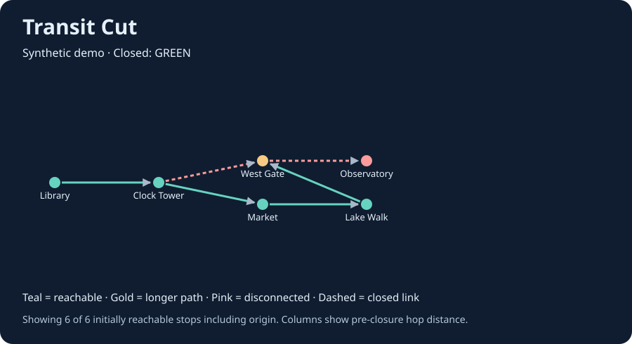

# Transit Cut

If a bus route closes, who loses access and who can take a longer path? Transit Cut compares the directed stop network before and after one or more route closures.



## Try it

Requires Python 3.9+ with no external packages. From this directory:

```sh
python transit_cut.py
python transit_cut.py --svg closure.svg
python transit_cut.py --close GREEN --close BLUE
python -m unittest discover -v
```

The fictional seven-stop fixture models parallel routes and a detour. Closing GREEN from Library disconnects Observatory. West Gate stays reachable, but the shortest path grows from two stop-to-stop hops to four. Reachable-destination counts exclude the origin.

An SVG preview displays up to five stops at each of the first six hop distances. The JSON result always covers the full network.

## Bring a network

Download an extract such as the [Delhi government's static GTFS feed](https://otd.delhi.gov.in/data/static/) separately and observe its terms. List IDs, choose an origin, and repeat `--close` for additional route IDs. Use a directory or a ZIP with the tables at its root.

```sh
python transit_cut.py --feed delhi.zip --list
python transit_cut.py --feed delhi.zip --origin YOUR_STOP_ID --close YOUR_ROUTE_ID
```

The parser uses stops, routes, trips and stop_times. It orders each trip's stops by numeric sequence, preserves direction, and keeps all services attached to shared links. Breadth-first search computes shortest paths by stop hops in the combined network. After building the graph, a query visits each reachable stop and link, plus the routes serving each visited link.

## Reading the result

This is physical connectivity across all trips in the file. Calendar, departure times, boarding restrictions, walking transfers and service frequency are outside the model. A theoretical path can require services that never connect on a given day. Delhi's agency also describes its bus times as approximate in the [feed documentation](https://otd.delhi.gov.in/documentation/). The bundled fixture contains only the four tables the model needs. It represents no actual operator or city.
